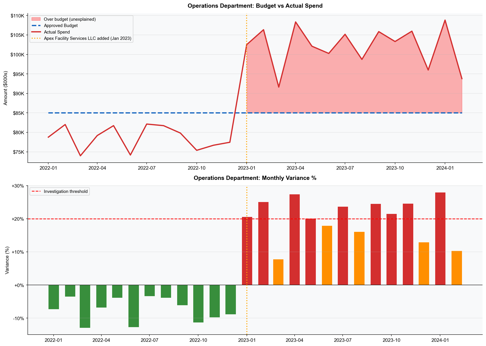
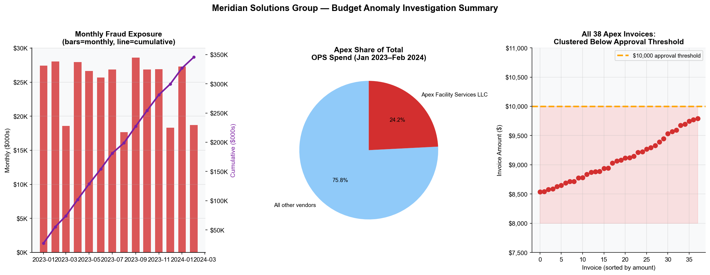

# Budget Anomaly Investigation — Meridian Solutions Group
## Internal Financial Forensics Report

---

## Scenario

> *"The Operations Department budget is over 20% without an approved variance request. My supervisor wants me to investigate — in case it's tampering, stealing, embezzlement, or unethical behavior."*

This project simulates a real-world internal forensic investigation. The Operations Department at Meridian Solutions Group (a fictional mid-size consulting firm) has been running 23.4% over budget for 14 consecutive months with no approved variance on file. The Director of Finance has tasked a data analyst with finding out why.

---

## What the Investigation Found

**$345,637** in unexplained expenditure traced to a single ghost vendor: **Apex Facility Services LLC** (V-2023-0891), added to the system by **Marcus Webb** (Operations Manager) in January 2023.

*Operations budget vs. actual, January 2022–February 2024. The dotted line marks January 2023, when Apex Facility Services LLC was added.*

*Summary chart saved by the notebook: monthly Apex exposure and the running total, Apex's share of Operations spend (January 2023–February 2024), and all 38 Apex invoices below the $10,000 approval threshold.*

Every one of the 38 invoices is structured between **$8,536 and $9,789** — consistently below the **$10,000 dual-approval threshold**. Marcus Webb added the vendor and serves as the sole approver for all Operations invoices. No W-9, no contract, no supporting documentation.

The pattern is consistent with a **fictitious vendor scheme** — the most common form of accounts payable fraud per the ACFE 2024 Global Fraud Report.

---

## Investigation Framework

| Phase | Analysis | Key Finding |
|---|---|---|
| 1 | Budget Variance Analysis | Operations is the only dept averaging >20% over budget |
| 2 | Temporal Pattern Analysis | Variance begins Jan 2023 — same month ghost vendor added |
| 3 | Transaction Deep Dive | Ghost vendor represents 24.2% of total OPS spend in period |
| 4 | Vendor Analysis | No W-9, no contract, no verifiable business existence |
| 5 | Fraud Indicators | 10/10 ACFE red flags present — 3 Critical, 3 High, 4 Medium |
| 6 | Findings & Recommendation | Escalate to HR and Legal; freeze vendor; preserve evidence |

---

## Deliverables

### 1. Jupyter Notebook ([budget_anomaly_investigation.ipynb](budget_anomaly_investigation.ipynb))
Six-phase investigation documented in Python:
- Budget variance analysis across all 8 departments
- Timeline reconstruction of when anomaly began
- Invoice distribution analysis showing structuring pattern
- Vendor cross-reference and self-approval audit
- ACFE fraud indicator scorecard
- Formal investigation findings memo

The notebook reads [budget_vs_actual.csv](budget_vs_actual.csv), [transaction_ledger.csv](transaction_ledger.csv), and [vendor_master.csv](vendor_master.csv).

### 2. Excel Audit Report ([Meridian_Budget_Investigation_Report.xlsx](Meridian_Budget_Investigation_Report.xlsx))
Five-sheet workbook formatted for stakeholder distribution:

| Sheet | Contents |
|---|---|
| **Investigation Summary** | Trigger, financial exposure, full fraud indicator scorecard, recommendation |
| **Budget vs Actual** | All 8 departments × 26 months — color-coded variance status |
| **Flagged Transactions** | All 38 ghost vendor invoices with evidence annotations |
| **Vendor Analysis** | Vendor master with documentation status and spend totals |
| **Remediation Actions** | 10 prioritized actions with owner, timeline, and status fields |

### 3. Charts and HTML dashboard
This repository does not include a Tableau workbook. The chart images saved by the notebook, and the HTML dashboard, are the visual files in the repo:

- [chart_01_variance_by_department.png](chart_01_variance_by_department.png) — average and total budget variance by department
- [chart_02_ops_timeline.png](chart_02_ops_timeline.png) — Operations budget vs. actual, marked at January 2023 when Apex Facility Services LLC was added
- [chart_03_invoice_distribution.png](chart_03_invoice_distribution.png) — Operations invoice amounts, and Apex invoices against the $10,000 approval threshold
- [chart_04_summary.png](chart_04_summary.png) — monthly exposure, Apex's share of Operations spend, and the 38 invoices below the approval threshold
- [investigation_dashboard.html](investigation_dashboard.html) — in-browser dashboard with the Operations budget-vs-actual timeline, department variance, cumulative Apex exposure, invoice clustering, the flagged invoice log, and the fraud-indicator scorecard

---

## The Fraud Pattern Explained

**Invoice structuring** is the deliberate splitting or sizing of transactions to stay below an approval threshold — in this case $10,000. It's the same concept as financial structuring (smurfing) in money laundering, applied to internal accounts payable.

The ACFE reports that asset misappropriation via fictitious vendor schemes:
- Accounts for 89% of occupational fraud cases
- Has a median loss of $120,000
- Takes an average of 14 months to detect without automated controls

In this scenario, the detection took exactly 14 months — and only because the budget variance finally crossed the 20% investigation trigger.

**The systemic fix** is not just catching Marcus Webb. It's closing the control gap: dual approval for vendor additions, W-9 required before first payment, and automated variance alerts at 10% (not 20%).

---

## Fraud Red Flags Identified

All 10 ACFE red flags from the fictitious vendor framework are present:

🔴 **Critical (3):** Invoice structuring below threshold | Vendor added and approved by same employee | No W-9 on file

🟠 **High (3):** No contract documentation | Anomaly starts at specific date and persists | Disproportionate vendor spend (24.2% of Operations spend)

🟡 **Medium (4):** Vague invoice descriptions | No supporting work orders | Single approval chain | Variance exceeds investigation trigger

---

## Synthetic Data Note

All company names, employee names, vendor names, and financial figures are entirely fictional and generated synthetically for portfolio purposes. The fraud patterns are modeled on documented real-world cases from ACFE literature and public enforcement actions.

---

## Author

**Alejandro (Alex) Molina**
GitHub: [@chooseyourtacoday](https://github.com/chooseyourtacoday)
Location: Dallas–Fort Worth, TX
Certifications: Codecademy BI Data Analyst | Databricks Analyst Associate (In Progress)
